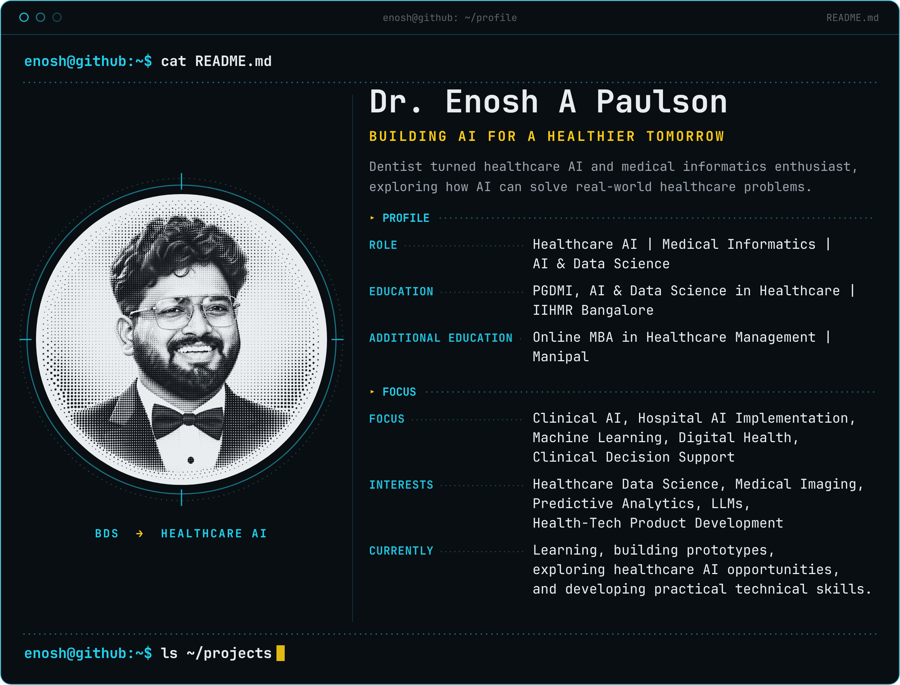
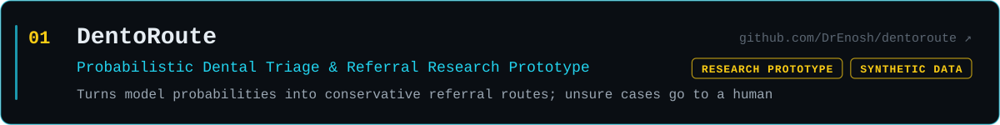
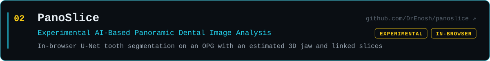
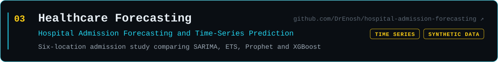
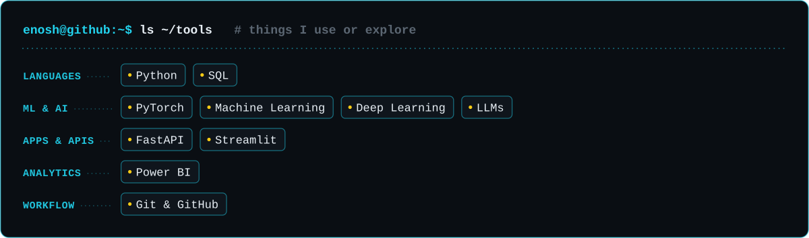

<!-- Profile README for github.com/DrEnosh. Images in assets/ are rebuilt by scripts/build_assets.py -->

  

### Featured Projects

*Research and educational prototypes. Not validated for clinical decision-making.*

### Tools & Technologies

### Connect

- **GitHub:** [github.com/DrEnosh](https://github.com/DrEnosh)
- **LinkedIn:** [linkedin.com/in/dr-enosh](https://www.linkedin.com/in/dr-enosh)
- **Email:** [enosh729@gmail.com](mailto:enosh729@gmail.com)

<b>Text version of this profile</b> (mobile and screen readers)

 

**Dr. Enosh A Paulson** 
Building AI for a healthier tomorrow

Dentist turned healthcare AI and medical informatics enthusiast, exploring how AI can solve real-world healthcare problems.

| | |
|---|---|
| **Role** | Healthcare AI · Medical Informatics · AI & Data Science |
| **Education** | PGDMI, AI & Data Science in Healthcare · IIHMR Bangalore |
| **Additional education** | Online MBA in Healthcare Management · Manipal |
| **Focus** | Clinical AI, Hospital AI Implementation, Machine Learning, Digital Health, Clinical Decision Support |
| **Interests** | Healthcare Data Science, Medical Imaging, Predictive Analytics, LLMs, Health-Tech Product Development |
| **Currently** | Learning, building prototypes, exploring healthcare AI opportunities, and developing practical technical skills. |

**Featured projects**

- [DentoRoute](https://github.com/DrEnosh/dentoroute): probabilistic dental triage and referral research prototype (synthetic data)
- [PanoSlice](https://github.com/DrEnosh/panoslice): experimental AI-based panoramic dental image analysis
- [Healthcare Forecasting](https://github.com/DrEnosh/hospital-admission-forecasting): hospital admission forecasting and time-series prediction

Research and educational prototypes. Not validated for clinical decision-making.

**Tools I use or explore:** Python, SQL, PyTorch, FastAPI, Streamlit, Power BI, machine learning, deep learning, Git & GitHub, LLMs

